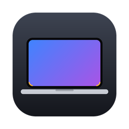

<p align="center">
  
</p>

<h1 align="center">Screen Corners</h1>

<p align="center">
  Rounded <b>bottom</b> corners for Apple Silicon MacBook displays.<br>
  <a href="README.ru.md">Русская версия</a>
</p>

---

## The problem

On M‑series MacBooks the display has rounded corners at the **top** but square corners at the **bottom**. macOS draws windows, the Dock and other UI with rounded corners everywhere, so the desktop wallpaper shows through in the bottom corners all the time.

**Screen Corners** draws two tiny black rounded masks in the bottom corners of the built-in display, so the screen looks evenly rounded all around.

- Sits above every window, the Dock and full-screen apps, on every desktop (Space)
- Clicks go straight through, nothing to get in the way
- Menu bar icon with a radius slider and toggles
- Launches at login and restarts itself after a crash
- Built-in display only, or all displays if you want
- Optional top-corner rounding too
- English and Russian interface
- No dependencies, a few hundred lines of Swift, built on your Mac from source

## Install

Open **Terminal** and run:

```bash
curl -fsSL https://raw.githubusercontent.com/PankovDefi/screen-corners/main/install.sh | bash
```

The installer downloads the source, builds the app, copies it to `/Applications`, turns on launch at login and starts it. An icon appears in the menu bar.

Options:

```bash
# set the radius right away (points, default 15)
curl -fsSL https://raw.githubusercontent.com/PankovDefi/screen-corners/main/install.sh | bash -s -- --radius 15

# don't launch at login
curl -fsSL https://raw.githubusercontent.com/PankovDefi/screen-corners/main/install.sh | bash -s -- --no-autostart
```

**Requirements:** macOS 13 Ventura or later, plus Xcode Command Line Tools (needed to build). If they're missing, the installer opens Apple's installer window. Wait for it to finish, then run the command again. The full Xcode app isn't required.

To update, run the install command again.

## Usage

Click the icon in the menu bar:

| Item | What it does |
|---|---|
| **Round corners** | Turn the masks on or off without quitting |
| **Radius slider** | Corner radius from 4 to 40 pt, changes live |
| **Reset radius** | Back to 15 pt |
| **Top corners too** | Also round the top corners (useful on external displays) |
| **External displays too** | Apply to every connected display, not only the built-in one |
| **Launch at login** | Start automatically when you log in |
| **Hide icon…** | Remove the icon from the menu bar. The corners keep working. To bring the icon back, open Screen Corners again from Applications or Spotlight. |
| **Quit** | Quit until the next login |

### Choosing the radius

15 pt is a good starting point. Move the slider until the bottom corners look the same as the top ones; the right value can differ slightly between MacBook models.

### Terminal settings

Settings live in the `com.screencorners.app` defaults domain:

```bash
defaults write com.screencorners.app radius -float 15
defaults write com.screencorners.app topCorners -bool true
defaults write com.screencorners.app allDisplays -bool true
defaults write com.screencorners.app hideIcon -bool false
```

Restart the app after changing settings this way:

```bash
pkill -x ScreenCorners; open -a ScreenCorners
```

## Uninstall

```bash
curl -fsSL https://raw.githubusercontent.com/PankovDefi/screen-corners/main/uninstall.sh | bash
```

This removes the app, the launch agent and the settings.

## Build from source

```bash
git clone https://github.com/PankovDefi/screen-corners.git
cd screen-corners
./scripts/build.sh              # → build/ScreenCorners.app
open build/ScreenCorners.app    # try it without installing
./install.sh --radius 15        # or install from the local checkout
```

## How it works

For every corner the app creates a small borderless, transparent window that ignores mouse events. Each window shows a black "square minus a quarter circle" shape. The windows sit at the screen-saver window level and join all Spaces, including full-screen ones. When displays change (plugging in a monitor, changing resolution, waking from sleep), the windows are rebuilt.

Launch at login uses a regular per-user LaunchAgent (`~/Library/LaunchAgents/com.screencorners.app.plist`). It's transparent and easy to remove, and it works for apps that aren't signed by Apple. `KeepAlive` restarts the app after a crash but not after you quit it from the menu.

## FAQ

**Do the corners show up in screenshots?**
The windows ask macOS to keep them out of screen capture. Recent macOS versions may ignore that request, so full-screen screenshots can still show the small black corners.

**Does it affect battery life?**
No. The app draws four tiny static windows and then sleeps. It does no work until the display configuration changes.

**macOS says "Background item added".**
That notification is normal for any app that starts at login. You can manage it in System Settings → General → Login Items.

**Why build from source instead of downloading an app?**
Apps without a paid Apple signature trigger Gatekeeper warnings. An app built on your own Mac doesn't, and you can read every line of code it runs.

## License

[MIT](LICENSE)
