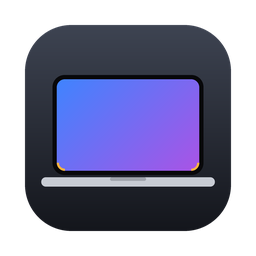

<p align="center">
  
</p>

<h1 align="center">Screen Corners</h1>

<p align="center">
  Скруглённые <b>нижние</b> углы экрана для MacBook на Apple Silicon.<br>
  <a href="README.md">English version</a>
</p>

---

## Проблема

У MacBook на процессорах M дисплей скруглён **сверху**, а снизу углы прямые. При этом окна, Dock и другие элементы macOS скруглены со всех сторон, и в нижних углах всё время просвечивают обои рабочего стола.

**Screen Corners** рисует в нижних углах встроенного экрана две маленькие чёрные скруглённые маски, и экран выглядит одинаково скруглённым со всех сторон.

- Видны поверх всех окон, Dock и полноэкранных приложений, на всех рабочих столах (Spaces)
- Не мешают кликам: мышь проходит сквозь них
- Иконка в строке меню со слайдером радиуса и переключателями
- Сами запускаются при входе в систему и перезапускаются после сбоя
- Работают только на встроенном экране или на всех мониторах, по выбору
- Можно скруглить и верхние углы
- Интерфейс на русском и английском
- Без зависимостей: несколько сотен строк на Swift, приложение собирается из исходников прямо на вашем Mac

## Установка

Откройте **Терминал** и выполните:

```bash
curl -fsSL https://raw.githubusercontent.com/YOUR_GITHUB_USER/screen-corners/main/install.sh | bash
```

Установщик скачает исходники, соберёт приложение, скопирует его в «Программы», включит автозапуск и запустит. В строке меню появится иконка.

Параметры:

```bash
# сразу задать радиус (в точках, по умолчанию 15)
curl -fsSL https://raw.githubusercontent.com/YOUR_GITHUB_USER/screen-corners/main/install.sh | bash -s -- --radius 15

# без автозапуска
curl -fsSL https://raw.githubusercontent.com/YOUR_GITHUB_USER/screen-corners/main/install.sh | bash -s -- --no-autostart
```

**Что нужно:** macOS 13 Ventura или новее и Xcode Command Line Tools (нужны для сборки). Если их нет, установщик откроет окно установки Apple. Дождитесь, пока она закончится, и запустите команду ещё раз. Полный Xcode не нужен.

Чтобы обновить приложение, снова выполните команду установки.

## Использование

Нажмите на иконку в строке меню:

| Пункт | Что делает |
|---|---|
| **Скруглять углы** | Включить или выключить маски, не закрывая приложение |
| **Слайдер радиуса** | Радиус от 4 до 40 pt, меняется сразу |
| **Сбросить радиус** | Вернуть 15 pt |
| **Верхние углы тоже** | Скруглить и верхние углы (пригодится на внешних мониторах) |
| **Внешние мониторы тоже** | Включить на всех подключённых мониторах, а не только на встроенном |
| **Запускать при входе** | Автозапуск при входе в систему |
| **Скрыть иконку…** | Убрать иконку из строки меню. Углы продолжат работать. Чтобы вернуть иконку, снова откройте Screen Corners из «Программ» или через Spotlight. |
| **Выйти** | Закрыть приложение до следующего входа в систему |

### Как подобрать радиус

15 pt по умолчанию — хорошая отправная точка. Двигайте слайдер, пока нижние углы не станут такими же, как верхние: у разных моделей MacBook подходящее значение может немного отличаться.

### Настройки через Терминал

Настройки хранятся в домене `com.screencorners.app`:

```bash
defaults write com.screencorners.app radius -float 15
defaults write com.screencorners.app topCorners -bool true
defaults write com.screencorners.app allDisplays -bool true
defaults write com.screencorners.app hideIcon -bool false
```

После такой настройки перезапустите приложение:

```bash
pkill -x ScreenCorners; open -a ScreenCorners
```

## Удаление

```bash
curl -fsSL https://raw.githubusercontent.com/YOUR_GITHUB_USER/screen-corners/main/uninstall.sh | bash
```

Команда удалит приложение, службу автозапуска и настройки.

## Сборка из исходников

```bash
git clone https://github.com/YOUR_GITHUB_USER/screen-corners.git
cd screen-corners
./scripts/build.sh              # → build/ScreenCorners.app
open build/ScreenCorners.app    # попробовать без установки
./install.sh --radius 15        # или установить из локальной копии
```

## Как это работает

Для каждого угла приложение создаёт маленькое прозрачное окно без рамки, которое не реагирует на мышь. В окне нарисована чёрная фигура «квадрат минус четверть круга». Окна находятся на уровне заставки (screen saver) и появляются на всех рабочих столах, включая полноэкранные. Когда меняется конфигурация экранов (подключили монитор, сменили разрешение, Mac проснулся), окна пересоздаются.

Автозапуск сделан через обычный пользовательский LaunchAgent (`~/Library/LaunchAgents/com.screencorners.app.plist`). Он прозрачный, его легко удалить, и он работает с приложениями без подписи Apple. `KeepAlive` перезапускает приложение после сбоя, но не после выхода через меню.

## Вопросы

**Углы видны на скриншотах?**
Окна просят macOS не попадать в снимки экрана. Новые версии macOS могут игнорировать эту просьбу, поэтому на скриншотах всего экрана маленькие чёрные уголки могут остаться.

**Влияет на батарею?**
Нет. Приложение рисует четыре крошечных неподвижных окна и больше ничего не делает, пока не изменится конфигурация экранов.

**macOS пишет «Добавлен фоновый объект».**
Это обычное уведомление для любой программы с автозапуском. Управлять им можно в «Системных настройках» → «Основные» → «Объекты входа».

**Почему сборка из исходников, а не готовое приложение?**
Приложения без платной подписи Apple вызывают предупреждения Gatekeeper. Приложение, собранное на вашем Mac, их не вызывает, и весь код, который оно выполняет, можно прочитать.

## Лицензия

[MIT](LICENSE)
